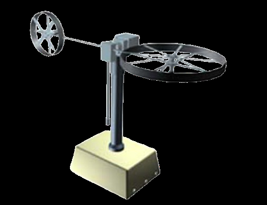
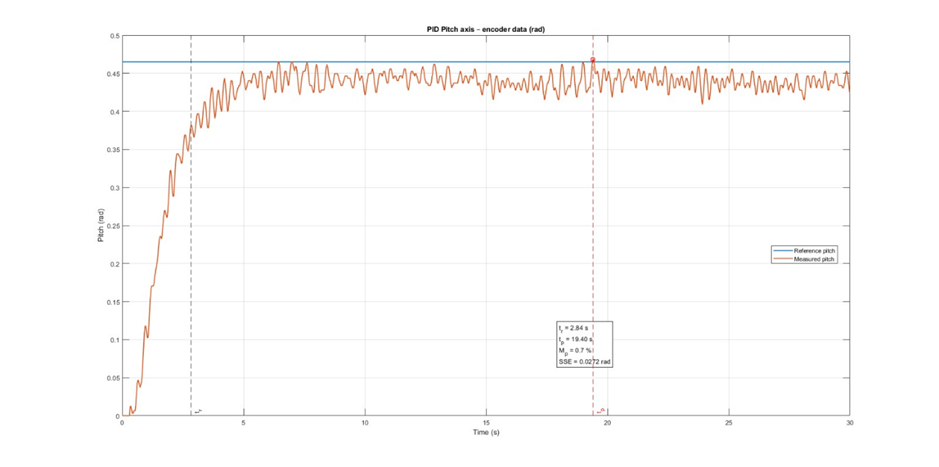
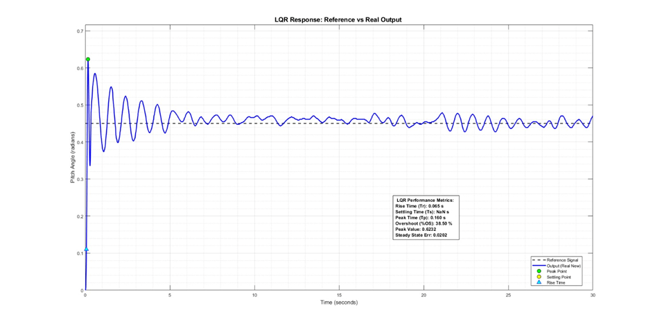

# Twin Rotor MIMO System — PID vs. LQR Control

**Mathematical modeling · MATLAB/Simulink simulation · Real-time experimental evaluation**

This repository documents a comparative study of **PID** and **Linear Quadratic Regulator (LQR)** control for a two-degree-of-freedom **Twin Rotor MIMO System (TRMS)**. The project combines nonlinear dynamic modeling, a seventh-order linear state-space representation, controller tuning, simulation, and tests on a physical TRMS platform.

> **Research scope:** The published comparison primarily evaluates **pitch-axis stabilization**. Both controllers were tested in simulation and on physical hardware. This repository does **not** claim that other control methods (e.g., SMC or H∞) were experimentally evaluated in this paper.



*Figure 1 from the research paper; original figure credited there to reference [2].*

## What is included

This is a **documentation and figure archive**, not a runnable MATLAB/Simulink release. The paper and its eight reproduced figures are included; original `.m`, `.slx`, embedded firmware, and raw experimental datasets have **not** been supplied. See [Reproduction guide](docs/09_reproduction_guide.md) for what is needed to rerun the work.

## Highlights

- Nonlinear pitch/yaw dynamics with gravity, friction, aerodynamic torque, and coupling.
- Seventh-order state-space model used for LQR design, **adopted from manufacturer documentation**, not directly identified from this apparatus.
- Classical PID benchmark compared with state-feedback LQR.
- MATLAB/Simulink modeling and physical experiments.
- Quantitative comparison of rise time, settling time, overshoot, and steady-state error.
- Analysis of the substantial simulation-to-hardware mismatch for LQR.

## Experimental results

| Metric | PID (physical system) | LQR (physical system) |
|:--|--:|--:|
| Rise time | 2.84 s | 0.065 s |
| Settling time | 19.40 s | > 30 s (not settled) |
| Overshoot | 0.7% | 38.50% |
| Steady-state error | 0.0272 | 0.0202 |

The LQR configuration had a faster initial rise but substantial oscillation and overshoot; PID achieved low overshoot and settled within the reported observation window. These numbers are **reported in Table IV of the paper**, not independently recomputed from raw data.

| PID hardware response | LQR hardware response |
|:--:|:--:|
|  |  |

## Modeling and controllers

The nonlinear pitch-axis equation is

$$J_v\ddot{\alpha}_v=\tau_v-\tau_{vg}-\tau_{vf}-\tau_{v,\mathrm{coup}}$$

and the yaw-axis equation is

$$J_h\ddot{\alpha}_h=\tau_h-\tau_{hf}-\tau_{h,\mathrm{coup}}.$$

For LQR design, the study uses $\dot{x}=Ax+Bu$ and $u=-Kx$, with a seven-state model and reported feedback gain

$$K=[-1.777,\ 1.000,\ 1.018,\ 0.219,\ 1.323,\ 0.703,\ 6.427].$$

The paper's final reported PID gains are $K_p=0$, $K_i=0.9$, $K_d=0.2$. See the documentation for the model assumptions, controller parameters, and interpretation caveats.

## Documentation

| Document | Contents |
|:--|:--|
| [System overview](docs/01_system_overview.md) | TRMS structure, research objectives, physical parameters |
| [Nonlinear modeling](docs/02_nonlinear_model.md) | Pitch/yaw equations, torque components, assumptions |
| [State-space model](docs/03_state_space_model.md) | Seventh-order matrices, provenance, dimensional notes |
| [PID controller](docs/04_pid_controller.md) | Control law, tuning, simulation and hardware response |
| [LQR controller](docs/05_lqr_controller.md) | Cost function, weights, gain, hardware mismatch |
| [Simulation results](docs/06_simulation_results.md) | Simulink figures and Table III |
| [Experimental results](docs/07_experimental_results.md) | Hardware plots and Table IV |
| [Results and limitations](docs/08_results_and_limitations.md) | Comparative discussion, evidence boundaries |
| [Reproduction guide](docs/09_reproduction_guide.md) | Requirements and missing artifacts |
| [Source review](docs/10_source_review_notes.md) | Open issues to verify before code release |
| [Source traceability](docs/11_traceability.md) | Page-by-page evidence map |
| [Results gallery](results/RESULTS.md) | All eight figures from the paper |

## Repository structure

```text
TRMS-PID-LQR-Control/
├── README.md
├── LICENSE
├── CITATION.cff
├── docs/
│   ├── 01_system_overview.md
│   ├── 02_nonlinear_model.md
│   ├── 03_state_space_model.md
│   ├── 04_pid_controller.md
│   ├── 05_lqr_controller.md
│   ├── 06_simulation_results.md
│   ├── 07_experimental_results.md
│   ├── 08_results_and_limitations.md
│   ├── 09_reproduction_guide.md
│   └── 10_source_review_notes.md
├── results/
│   ├── RESULTS.md
│   └── figures/              # 8 figures extracted from the paper
├── paper/
│   └── TRMS_Final_Paper_Senturk_Acar_Deri.pdf
├── matlab/                  # source code pending review
├── firmware/                # source code pending review
└── hardware/                # wiring/parts evidence pending review
```

## Technical verification notes

The paper presents a seventh-order model with a **two-column input matrix** but reports a **scalar input penalty** and a **single-row LQR gain**. Those representations require reconciliation against the original MATLAB implementation before a working multi-input controller can be reconstructed. Reported experimental metrics are transcribed from the manuscript, not recalculated from measurements.

## Authors and attribution

**Yusuf Selim Şentürk · Ömer Hamza Acar · Mustafa Deri**  
Department of Electrical and Electronics Engineering, İzmir Kâtip Çelebi University, Türkiye.

Research paper: *Comparative Analysis of Classical PID and Optimal LQR Control Strategies for a Twin Rotor MIMO System: Simulation and Real-Time Implementation* ([PDF](paper/TRMS_Final_Paper_Senturk_Acar_Deri.pdf)). Publication venue and DOI are **not specified** in the supplied manuscript.

**Figure provenance:** The eight images in `results/figures/` were extracted from the supplied paper. Figure 1 credits a third-party source in the manuscript. The images are provided as research-paper excerpts, not as independently licensed original image assets; review reuse permissions before public distribution.

## Status

**Documentation package complete; reproducible source package not yet available.** No MATLAB/Simulink project files, firmware, raw data, or verified hardware schematics were supplied with this paper. These directories are placeholders and do not imply that their implementations are included.
