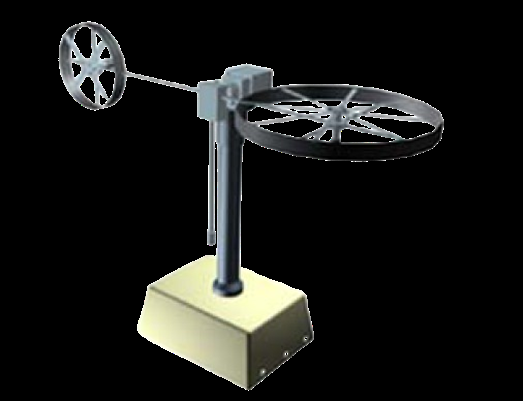

# 01 — System Overview

## Research goal
Compare classical PID with LQR for a nonlinear, cross-coupled two-degree-of-freedom Twin Rotor MIMO System, using MATLAB/Simulink and physical experiments. The main quantitative experiment is pitch stabilization (paper Sections II, V and VI).

## Platform
The laboratory system has a main rotor for vertical/pitch actuation and a tail rotor for horizontal/yaw actuation. Gravity, friction, rotor-generated aerodynamic torques, gyroscopic interaction and cross-reaction complicate control. The setup is described as manufactured by Feedback Instruments. The supplied paper does not establish the exact embedded processor, driver boards, encoder model, sample rate or wiring used in these tests.

*Paper Figure 1, attributed there to reference [2].*

## Physical parameters (paper Table I)

| Parameter | Symbol | Value | Unit |
|:--|:--|--:|:--|
| Vertical inertia | $J_v$ | 0.068 | kg·m² |
| Horizontal inertia | $J_h$ | 0.020 | kg·m² |
| Gravity moment coefficient | $M_g$ | 0.32 | N·m |
| Vertical viscous friction | $B_{1v}$ | 0.006 | N·m·s/rad |
| Vertical Coulomb friction | $B_{2v}$ | 0.001 | N·m |
| Horizontal viscous friction | $B_{1h}$ | 0.1 | N·m·s/rad |
| Horizontal Coulomb friction | $B_{2h}$ | 0.01 | N·m |
| Gyroscopic constant | $K_{gy}$ | 0.05 | s/rad |
| Cross-coupling gain | $k_c$ | -0.2 | — |
| Main motor coefficients | $a_1,b_1$ | 0.0135, 0.0924 | as reported |
| Tail motor coefficients | $a_2,b_2$ | 0.02, 0.09 | as reported |

The paper does not specify measurement uncertainties for these parameters.
