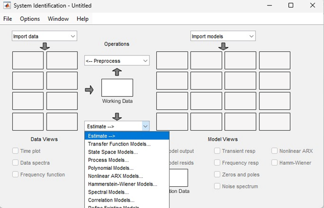

# 03 — Linear State-Space Model

*Source: paper Section III.B–C, equations (10)–(15).*

The theoretical four-state representation uses pitch and yaw angles and angular velocities. For controller design, the study uses a **seventh-order** model obtained from manufacturer documentation, rather than direct system identification on the specific experimental rig (Section III.C).

$$\dot{x}=Ax+Bu,\qquad y=Cx+Du.$$

The paper gives:

```text
A = [  0      0      1       0       0      0       0;
       0      0      0       1       0      0       0;
      -4.34   0     -0.088   0       1.24   0       0;
       0      0      0     -51.48   23.6    0       0;
      18.75   0      0       0       0      0      -0.83;
       0      0      0       0       0      0    -100;
       0      0      0      -0.017   0     -0.5     0 ]

B = [0 0;
     0 0;
     0 0;
     0 0;
     1 0;
     0 1;
     0 0]

C = [1 0 0 0 0 0 0;
     0 1 0 0 0 0 0]

D = zeros(2,2)
```

**Transcription caution:** The manuscript typesets the matrices in two columns and does not define all seven augmented states. Verify every entry and state ordering against the original MATLAB model before executing or publishing reconstructed scripts. The matrix above is a transcription of the paper, not an independently validated software artifact.



*Paper Figure 2 is captioned “System Identification Result,” although Section III.C says direct identification on this rig was not possible. Treat this as a figure from the manuscript, not proof of newly collected identification data.*
