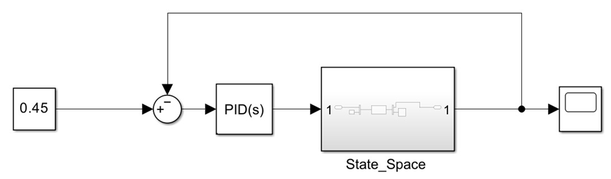
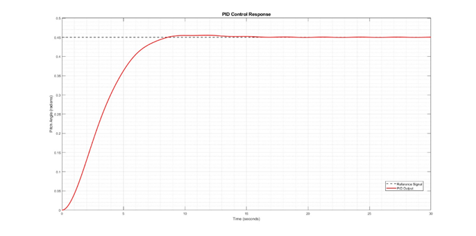
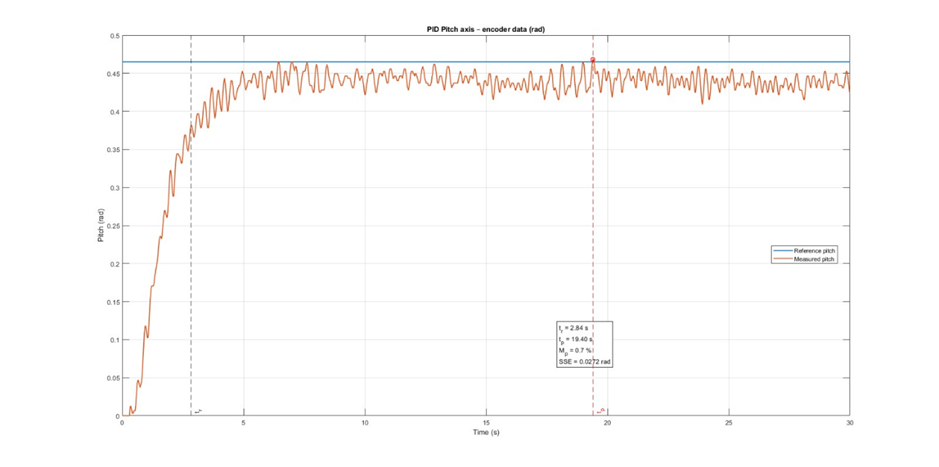

# 04 — PID Controller

*Source: paper Section IV.A, Table II and Section V.*

The paper describes decentralized PID control for pitch and yaw, with each loop operating on its own tracking error:

$$u(t)=K_pe(t)+K_i\int_0^t e(\tau)\,d\tau+K_d\frac{de(t)}{dt}.$$

## Reported final gains

| Parameter | Value |
|:--|--:|
| $K_p$ | 0 |
| $K_i$ | 0.9 |
| $K_d$ | 0.2 |

These are **the gains printed in Table II**. The manuscript does not separately provide complete final gain sets for both pitch and yaw axes. Initial tuning is described as Ziegler–Nichols reaction-curve-based, followed by experimental refinement.

## Reported performance

| Metric | Simulation | Physical hardware |
|:--|--:|--:|
| Rise time | 4.950 s | 2.84 s |
| Settling time | 7.754 s | 19.40 s |
| Overshoot | 1.15% | 0.7% |
| Steady-state error | 0.0002 | 0.0272 |

The physical response exhibited prolonged oscillation relative to the simulation, although it reached the paper's reported settling criterion. No raw time series or executable PID implementation was supplied with the PDF.
