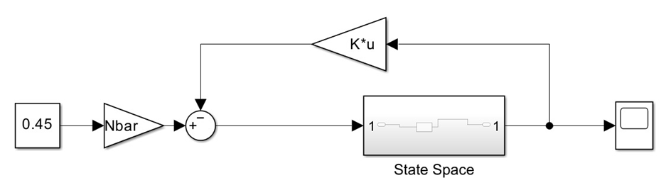
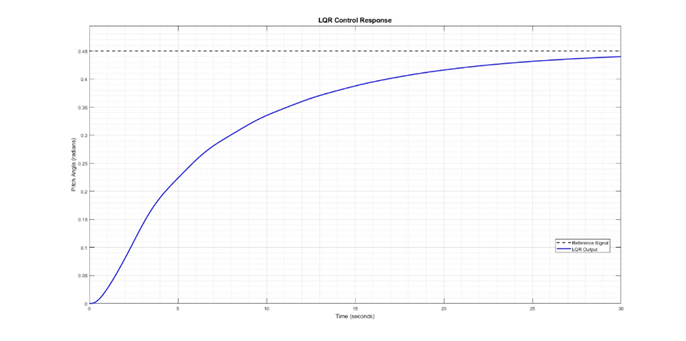
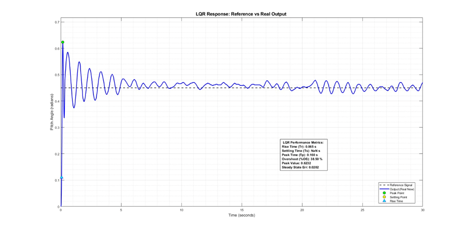

# 05 — LQR Controller

*Source: paper Section IV.B, equations (17)–(20), Sections V–VI.*

The state-feedback law is $u=-Kx$, minimizing

$$J=\int_0^\infty(x^TQx+u^TRu)\,dt.$$

The paper states $Q=\mathrm{diag}(5.78,1,1,1,1,1,1)$ and prints $R=[1]$ and the feedback gain

$$K=[-1.777,\ 1.000,\ 1.018,\ 0.219,\ 1.323,\ 0.703,\ 6.427].$$

**Consistency note:** The printed plant has **two input columns**, while the paper reports a scalar $R$ and a **single-row** $K$. These dimensions are not sufficient to reconstruct an unambiguous full two-input LQR design. The original code, selected input channel and exact control architecture must be checked before claiming reproducibility. We preserve the paper's values rather than guessing corrections.

## Reported performance

| Metric | Simulation | Physical hardware |
|:--|--:|--:|
| Rise time | 16.306 s | 0.065 s |
| Settling time | >30 s | >30 s |
| Overshoot | 0% | 38.50% |
| Steady-state error | 0.0101 | 0.0202 |

The physical LQR response was much faster but oscillatory, with high overshoot and no reported settling within the observation window. The manuscript proposes unmodeled actuator and aerodynamic effects as possible explanations; those causes were not individually isolated experimentally.
