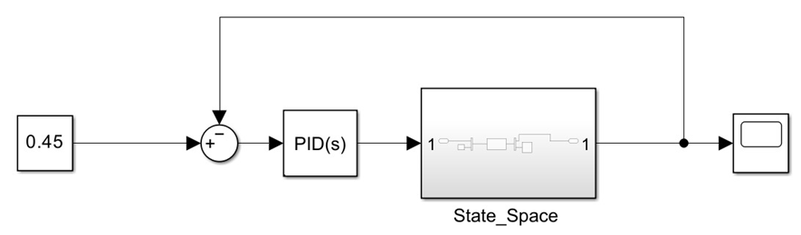
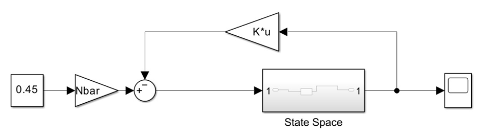
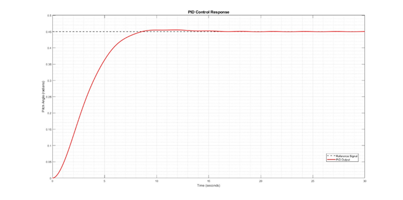
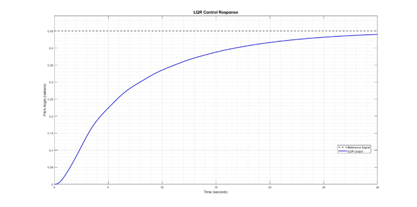

# 06 — Simulation Results

*Source: paper Section V.A, Figures 3–6 and Table III.*

Controllers were evaluated in MATLAB/Simulink before physical implementation.

## Quantitative comparison — Table III

| Metric | PID | LQR |
|:--|--:|--:|
| Rise time | 4.950 s | 16.306 s |
| Settling time | 7.754 s | >30 s |
| Peak time | 11.820 s | 30.000 s |
| Overshoot | 1.15% | 0% |
| Steady-state error | 0.0002 | 0.0101 |

The reported PID simulation is faster and settles within the reported window. The reported LQR simulation has no overshoot but does not settle within 30 seconds.

## Simulink diagrams

## Pitch responses

**Reporting note:** Narrative discussion around Figures 5–6 describes the PID overshoot qualitatively as significant, but Table III reports only 1.15%. This repository uses the numerical values in Table III without silently reconciling the discrepancy. Exact reference magnitude, sample time, solver settings and logged raw data are not supplied.
