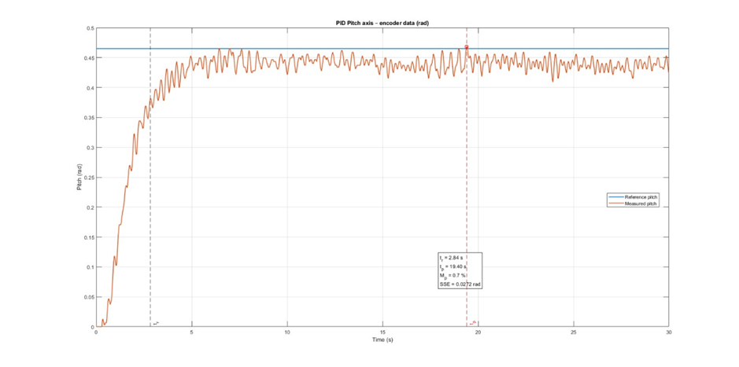
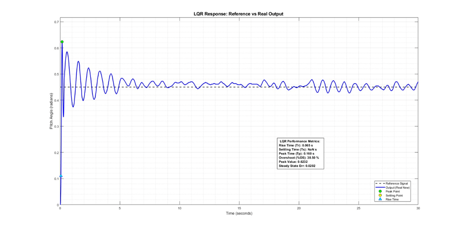

# 07 — Real-Time Experimental Results

*Source: paper Section V.B, Figures 7–8, Table IV and Section VI.*

The manuscript reports compiling/downloading both controllers to the physical TRMS and applying a step reference. The supplied manuscript does not identify the exact embedded processor, software build procedure, driver circuit or data acquisition configuration.

## Quantitative comparison — Table IV

| Metric | PID | LQR |
|:--|--:|--:|
| Rise time | 2.84 s | 0.065 s |
| Settling time | 19.40 s | >30 s (NaN in table) |
| Overshoot | 0.7% | 38.50% |
| Steady-state error | 0.0272 | 0.0202 |

## Interpretation

- **PID:** lower overshoot and eventual settling, though with oscillatory behavior.
- **LQR:** extremely fast initial rise, but strong overshoot and sustained oscillations; it did not settle within the observation window.
- **Model mismatch:** simulation and hardware responses differ substantially, particularly for LQR.

The paper discusses coupling rejection and smoother LQR control effort, but does **not** provide a complete numerical coupling-rejection dataset or energy measurement table. Those claims should not be presented as quantitatively demonstrated here.

**Units:** Table IV does not specify the units of the steady-state-error entries; the surrounding text explicitly gives 0.0272 rad for PID. Do not assume both columns were independently unit-verified.
