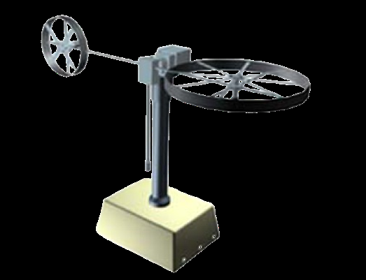
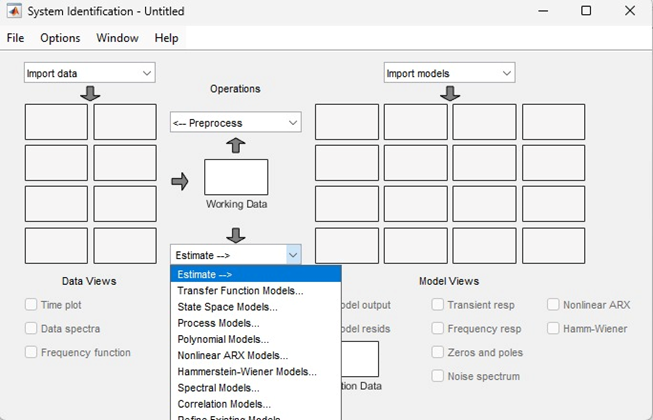
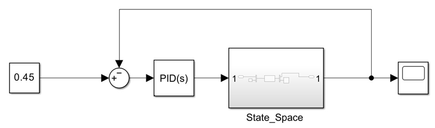
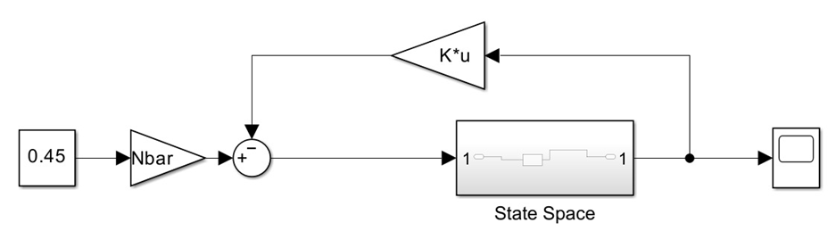
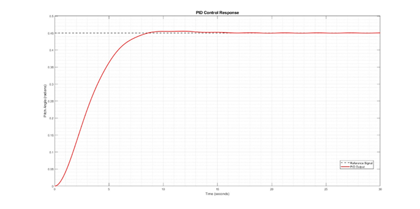
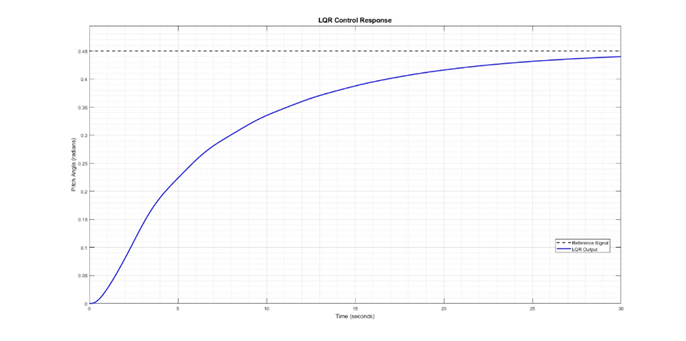
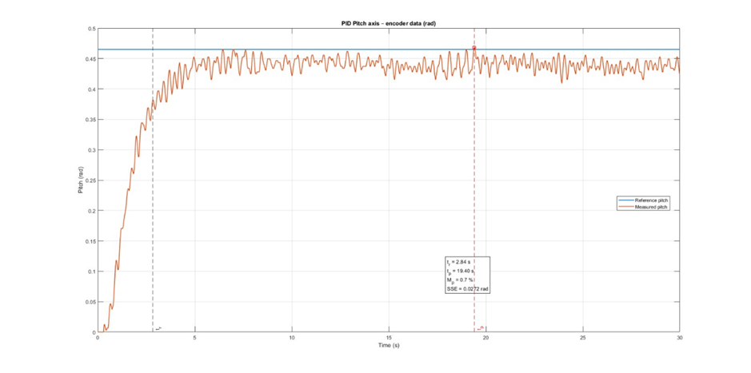
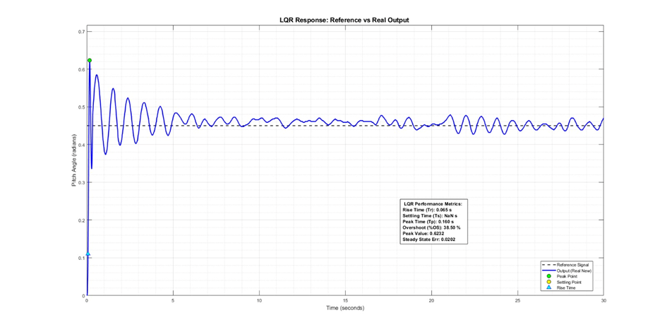

# Results and Figures

The eight images below were **extracted from the six-page supplied research paper**. They are paper figure assets, not raw numerical datasets. Figure numbers correspond to the manuscript.

## System and modeling

**Figure 1 — TRMS experimental setup** (paper page 2; source credited in manuscript to reference [2]).

**Figure 2 — System identification result** (paper page 3). The caption is reproduced as printed; the text says the seventh-order model was adopted from manufacturer documentation rather than identified on this particular apparatus.

## Controller simulation diagrams

**Figure 3 — PID Simulink block diagram.**

**Figure 4 — LQR Simulink block diagram.**

## Simulation pitch-axis step responses

**Figure 5 — PID simulation step response.** Table III: 4.950 s rise, 7.754 s settling, 1.15% overshoot.

**Figure 6 — LQR simulation step response.** Table III: 16.306 s rise, >30 s settling, 0% overshoot.

## Physical-system pitch-axis responses

**Figure 7 — Real-time PID response.** Table IV: 2.84 s rise, 19.40 s settling, 0.7% overshoot.

**Figure 8 — Real-time LQR response.** Table IV: 0.065 s rise, >30 s settling, 38.50% overshoot.

## Complete comparison

| Metric | PID simulation | LQR simulation | PID hardware | LQR hardware |
|:--|--:|--:|--:|--:|
| Rise time | 4.950 s | 16.306 s | 2.84 s | 0.065 s |
| Settling time | 7.754 s | >30 s | 19.40 s | >30 s |
| Overshoot | 1.15% | 0% | 0.7% | 38.50% |
| Steady-state error | 0.0002 | 0.0101 | 0.0272 | 0.0202 |

These values are transcribed from manuscript Tables III–IV, without recomputation. See [results and limitations](../docs/08_results_and_limitations.md) for interpretation and caveats.
